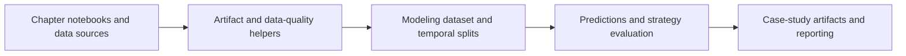
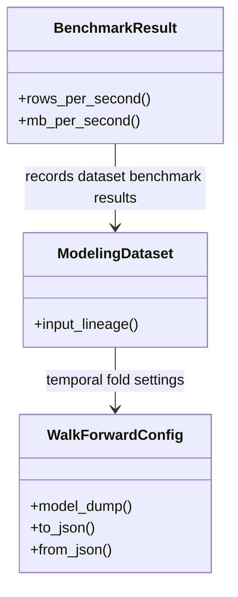
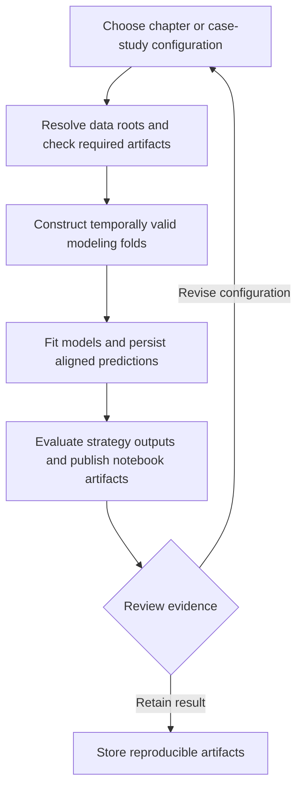
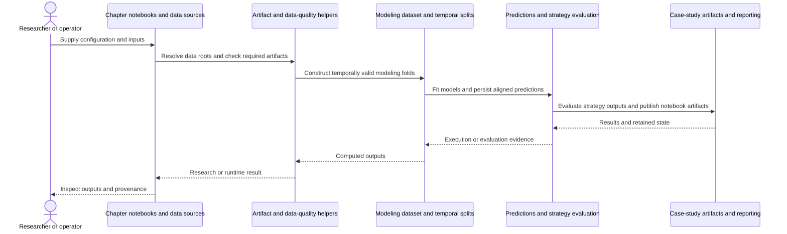
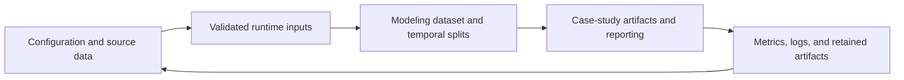
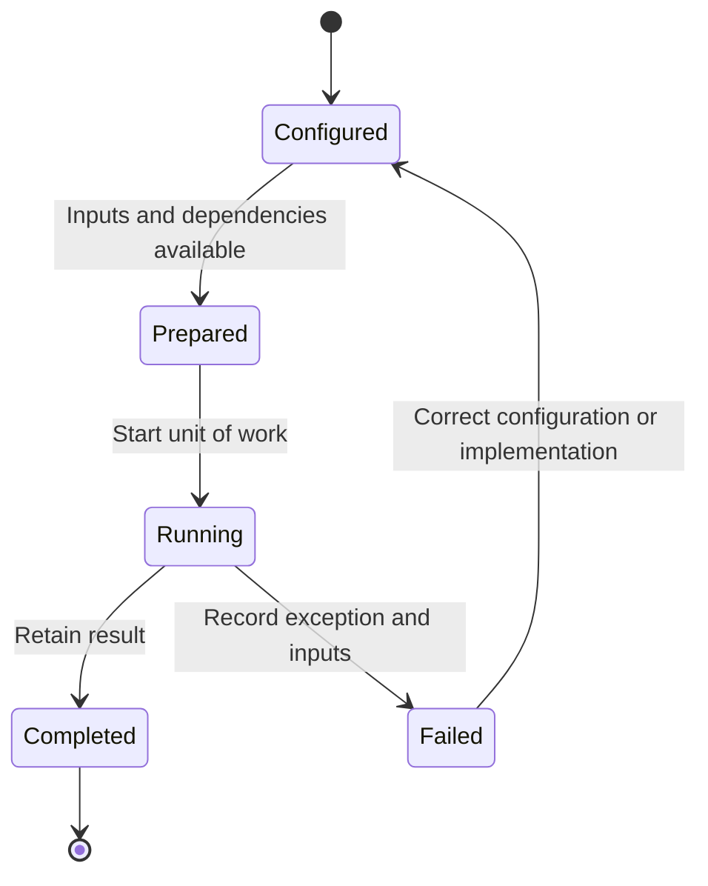

# Machine Learning for Trading: workflow and architecture

Updated 2026-10-12. Source baseline: `50bd74eef37969463182037e60679bffe2752f12` on `feature/ayu_develop`. See [development commands](development.md) and [validation evidence](validation.md) for the tested environment and current limitations.

## Purpose and features

Provides the current ML4T curriculum and case-study pipeline for data preparation, features, temporally valid model evaluation, predictions, and strategy analysis.

- Chapter notebooks and paired Python sources
- Reusable case-study modeling and artifact utilities
- Walk-forward and cross-validation configuration
- Data quality, reproducibility, and storage benchmarks
- Backtesting, live trading, MLOps, and agent examples

## Component architecture

This is an educational research repository rather than one service process. Numbered chapters demonstrate capabilities and reusable utilities govern modeling datasets, temporal splits, artifacts, and reproducibility. The sitecustomize module exposes chapter imports in the managed environment. Runtime outputs and production artifacts live outside committed source paths or in ignored workspaces. Temporal evaluation is central: training, validation, and test periods must remain explicit when preparing predictions for downstream strategy analysis.

The diagram shows responsibility boundaries in the main research or execution path. Concrete entry points and implementation files are linked below.

## Core types

The types below belong to the public or native boundary described by the linked implementation. Arrows describe the dependency or ownership relationship used in the documented workflow. Listed Python methods are present in the linked source; native array types represent the binding boundary.

## End-to-end workflow

1. Choose chapter or case-study configuration.
2. Resolve data roots and check required artifacts.
3. Construct temporally valid modeling folds.
4. Fit models and persist aligned predictions.
5. Evaluate strategy outputs and publish notebook artifacts.

## Interaction sequence

The sequence follows one unit of work. Results return across the same boundaries that accepted the configuration and data. External I/O and numerical execution have different failure modes and should retain separate evidence.

## Data and artifact lifecycle

Inputs include explicit strategy or model settings, data selection, and execution assumptions. Retaining these with outputs makes a rerun reviewable. Temporary environments and caches remain development artifacts, while source-controlled configuration documents intended behavior.

## Execution and failure boundaries

Large production datasets, notebook execution, provider credentials, database servers, Chrome for Kaleido, and specialized machine-learning wheels are separate requirements. Optional environments cover packages with narrower interpreter support. A package build does not execute every notebook or provision every dataset, and test evidence records those limits explicitly.

This state diagram describes the documented workflow, not a claim that these names are an implementation enum. Failure evidence should identify whether input preparation, external services, native compilation, or application execution failed.

## Development layout

The upstream chapter, utils/, data/, case_studies/, and scripts/ layout is preserved because chapter imports and notebook-relative paths are part of the curriculum. The upstream setuptools build and managed uv environment are retained.

## Source map

| Existing source | Responsibility evidence |
|---|---|
| [utils/modeling.py](../utils/modeling.py#L63) | Implementation and module/type documentation, beginning at line 63 |
| [utils/cv_splits.py](../utils/cv_splits.py#L63) | Implementation and module/type documentation, beginning at line 63 |
| [utils/artifact_specs.py](../utils/artifact_specs.py#L21) | Implementation and module/type documentation, beginning at line 21 |
| [utils/data_quality.py](../utils/data_quality.py#L27) | Implementation and module/type documentation, beginning at line 27 |
| [utils/reproducibility.py](../utils/reproducibility.py#L15) | Implementation and module/type documentation, beginning at line 15 |
| [utils/predictions_cache.py](../utils/predictions_cache.py#L62) | Implementation and module/type documentation, beginning at line 62 |
| [utils/paths.py](../utils/paths.py#L130) | Implementation and module/type documentation, beginning at line 130 |
| [utils/config.py](../utils/config.py#L1) | Implementation and module/type documentation, beginning at line 1 |
| [utils/downloading.py](../utils/downloading.py#L31) | Implementation and module/type documentation, beginning at line 31 |
| [utils/storage_benchmarks.py](../utils/storage_benchmarks.py#L43) | Implementation and module/type documentation, beginning at line 43 |
| [utils/style.py](../utils/style.py#L172) | Implementation and module/type documentation, beginning at line 172 |
| [sitecustomize.py](../sitecustomize.py#L57) | Implementation and module/type documentation, beginning at line 57 |
| [pyproject.toml](../pyproject.toml#L1) | Implementation and module/type documentation, beginning at line 1 |

The links target files present in this checkout. Follow their imports and adjacent tests when changing a boundary. The validation document distinguishes successful builds, complete test runs, inherited skips, and unresolved prerequisites.
