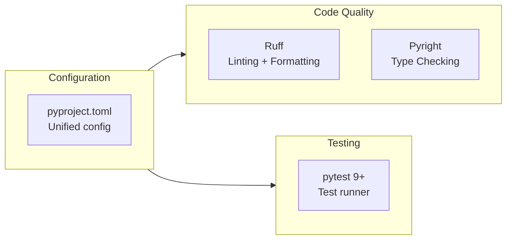
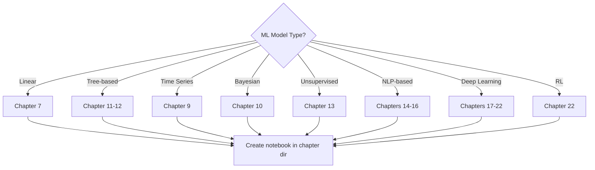
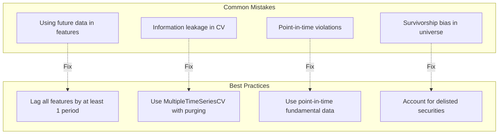
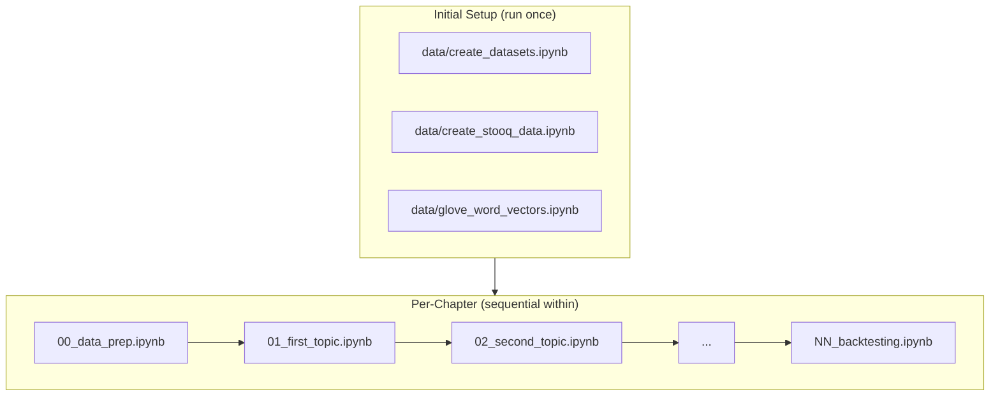

# Development Guide

> Development standards, adding new strategies and models, ML best practices for trading,
> and contribution guidelines for Machine Learning for Trading.

## Environment Setup

### Prerequisites

Use uv 0.13.0 and the repository's `.python-version` (CPython 3.14.8). The complete
539-package lock includes direct, development, notebook, and optional dependencies.
The unchanged third-edition layout keeps chapter scripts, notebooks, `data/`,
`utils/`, and `case_studies/` beside their relative resource paths.

```bash
uv python install 3.14.8
uv sync --frozen --all-groups --all-extras
uv run --no-sync pytest
uv build
```

The platform Conda specifications below remain reference environments for the
book's separately provisioned GPU and vendor-data workflows. For this maintained
checkout, `pyproject.toml` and `uv.lock` define installation and dependency updates:

```bash
uv lock --upgrade
uv sync --frozen --all-groups --all-extras
```

CPython 3.15 cannot resolve the current complete extras: Feast requires Pandas below
3, while the available Python 3.15 backtesting stack requires Pandas 3. Python 3.13
was also installed and fully resolved as a native-crash control; it did not make the
full test suite pass. Python 3.14.8 remains the highest buildable complete environment.
See [validation](validation.md) for all failed and successful commands.

### Platform-Specific Configs

| Platform | Directory |
|----------|-----------|
| Linux | `installation/linux/` |
| macOS | `installation/macosx/` |
| Windows | `installation/windows/` |

## Code Quality Standards

### Tooling

The project uses modern Python tooling configured in `pyproject.toml`:



### Ruff Configuration

```toml
[tool.ruff]
line-length = 88
target-version = "py313"

[tool.ruff.lint]
select = ["E", "W", "F", "I", "UP", "B", "SIM", "C4", "RUF", "PERF", "TC", "PTH"]
ignore = ["E501"]
```

Key rule categories enabled:
- **E/W**: pycodestyle errors and warnings
- **F**: pyflakes (unused imports, undefined names)
- **I**: isort-compatible import sorting
- **UP**: pyupgrade (modern Python syntax)
- **B**: flake8-bugbear (common pitfalls)
- **SIM**: flake8-simplify (code simplification)
- **PERF**: performance anti-patterns
- **PTH**: pathlib preference over os.path

### Running Quality Checks

```bash
# Lint all Python files
ruff check .

# Auto-fix issues
ruff check --fix .

# Format code
ruff format .

# Type checking
pyright

# Run tests
pytest
```

## Project Conventions

### Directory Structure for Chapters

Each chapter follows a consistent structure:

```
NN_chapter_name/
├── README.md                              # Chapter overview, content, resources
├── __init__.py                            # Package marker (where applicable)
├── 00_data_prep.ipynb                     # Data preparation (if needed)
├── 01_first_topic.ipynb                   # Sequential topic coverage
├── 02_second_topic.ipynb
├── ...
├── NN_backtesting_with_zipline.ipynb      # Backtesting (if applicable)
└── results/                               # Persisted model artifacts (optional)
```

### Notebook Naming

- Prefix with two-digit sequential number: `01_`, `02_`, etc.
- Use lowercase with underscores
- Names should describe the content clearly
- `00_` prefix for setup/data preparation notebooks
- Final notebooks in a chapter often cover backtesting

### Python Script Conventions

Standalone scripts (`.py` files) follow these patterns:

- Author attribution: `__author__ = 'Stefan Jansen'`
- Random seed: `np.random.seed(42)` for reproducibility
- Relative paths using `pathlib.Path`
- Type hints for function signatures

## Adding a New Strategy

### Step 1: Choose a Chapter Context

Determine which part of the project your strategy relates to:



### Step 2: Data Preparation

```python
# Standard data loading pattern
from pathlib import Path
import pandas as pd
import numpy as np

np.random.seed(42)

PROJECT_DIR = Path('..', '..')
DATA_DIR = PROJECT_DIR / 'data'

# Load from shared store
with pd.HDFStore(DATA_DIR / 'assets.h5') as store:
    prices = store['quandl/wiki/prices']
```

### Step 3: Feature Engineering

Use the alpha factor library (Chapter 24) as a starting point:

```python
import talib

# Technical indicators
df['SMA_20'] = talib.SMA(df['close'], timeperiod=20)
df['RSI_14'] = talib.RSI(df['close'], timeperiod=14)
df['MACD'], df['MACD_signal'], df['MACD_hist'] = talib.MACD(df['close'])

# Custom factors from Chapter 24
# See 24_alpha_factor_library/02_common_alpha_factors.ipynb
```

### Step 4: Model Training with Time-Series CV

Always use `MultipleTimeSeriesCV` from `utils.py` for validation:

```python
import sys
sys.path.insert(0, str(PROJECT_DIR))
from utils import MultipleTimeSeriesCV

cv = MultipleTimeSeriesCV(
    n_splits=12,
    train_period_length=252,
    test_period_length=63,
    lookahead=1,
    date_idx='date'
)

for train_idx, test_idx in cv.split(X):
    model.fit(X.iloc[train_idx], y.iloc[train_idx])
    predictions.append(model.predict(X.iloc[test_idx]))
```

### Step 5: Signal Evaluation with Alphalens

```python
from alphalens import utils, tears

factor_data = utils.get_clean_factor_and_forward_returns(
    factor=signals,
    prices=prices,
    quantiles=5,
    periods=(1, 5, 21)
)

tears.create_full_tear_sheet(factor_data)
```

### Step 6: Backtesting

Choose the appropriate backtesting approach:

| Approach | When to Use | Example |
|----------|-------------|---------|
| Vectorized | Quick iteration, simple signals | `08/.../02_vectorized_backtest.ipynb` |
| Backtrader | Realistic execution, complex logic | `08/.../03_backtesting_with_backtrader.ipynb` |
| Zipline | Full ML integration, pipeline API | `08/.../04_ml4t_workflow_with_zipline/` |

### Step 7: Performance Evaluation

```python
import pyfolio as pf

pf.create_full_tear_sheet(
    returns=strategy_returns,
    positions=positions,
    transactions=transactions,
    benchmark_rets=benchmark_returns
)
```

## ML Best Practices for Trading

### Avoiding Look-Ahead Bias



### Key Principles

1. **Time-series aware validation**: Never use standard k-fold CV on financial time series.
   Always use `MultipleTimeSeriesCV` or `TimeSeriesSplit` with appropriate purging gaps.

2. **Multiple testing correction**: When testing many strategies, apply statistical corrections
   (Chapter 8, `01_multiple_testing/`). A single good backtest among many trials is likely noise.

3. **Transaction costs**: Include realistic transaction costs in backtests. Vectorized backtests
   often omit these, leading to overly optimistic results.

4. **Regime awareness**: Financial markets change regimes. Train on diverse market conditions
   and evaluate robustness across regimes.

5. **Feature importance stability**: Check that feature importance is stable across time periods.
   Chapter 12 demonstrates SHAP analysis for this purpose.

### Common Pitfalls

| Pitfall | Chapter Reference | Mitigation |
|---------|-------------------|------------|
| Overfitting | Ch 6 (`03_bias_variance.ipynb`) | Regularization, early stopping, ensemble methods |
| Data snooping | Ch 8 (`01_multiple_testing/`) | FDR control, out-of-sample holdout |
| Survivorship bias | Ch 2 | Use point-in-time databases |
| Lookahead bias | Ch 6, 8 | Strict temporal separation in CV |
| Regime change | Ch 9, 10 | Rolling windows, Bayesian updating |
| Overly complex models | Ch 6 | Start simple, increase complexity only if justified |
| Ignoring transaction costs | Ch 5, 8 | Include slippage, commissions, market impact |

## Adding New Alpha Factors

### Using the Alpha Factor Library

Chapter 24 provides the framework for creating and evaluating new factors:

1. **Define the factor** in a function that takes OHLCV data and returns a signal Series
2. **Compute across the universe** using `04_alpha_factor_research/01_feature_engineering.ipynb` patterns
3. **Evaluate with Alphalens** using `24_alpha_factor_library/05_alphalens_analysis.ipynb`
4. **Compare with existing factors** using mutual information (`06/.../02_mutual_information.ipynb`)

### TA-Lib Factor Template

```python
import talib
import pandas as pd

def compute_custom_factor(df: pd.DataFrame) -> pd.Series:
    """Compute a custom alpha factor.

    Args:
        df: DataFrame with OHLCV columns

    Returns:
        Series with factor values, indexed by date
    """
    # Combine multiple indicators
    rsi = talib.RSI(df['close'], timeperiod=14)
    bb_upper, bb_middle, bb_lower = talib.BBANDS(df['close'])
    atr = talib.ATR(df['high'], df['low'], df['close'])

    # Custom signal logic
    signal = (df['close'] - bb_middle) / atr
    signal = signal.where(rsi < 70)  # Filter by RSI

    return signal
```

## Testing

### Test Configuration

Tests are configured in `pyproject.toml`:

```toml
[tool.pytest.ini_options]
minversion = "9.0"
addopts = ["-ra", "-q", "--strict-markers", "--import-mode=importlib"]
testpaths = ["tests"]
pythonpath = ["src"]
xfail_strict = true
filterwarnings = ["error"]
```

### Running Tests

```bash
# Run all tests
pytest

# Run with verbose output
pytest -v

# Run specific test file
pytest tests/test_specific.py

# Run with coverage
pytest --cov=. --cov-report=html
```

### Writing Tests for Trading Code

```python
import pytest
import numpy as np
import pandas as pd
from utils import MultipleTimeSeriesCV


def test_multiple_time_series_cv_splits():
    """Test that CV generates correct number of splits."""
    dates = pd.date_range('2020-01-01', periods=500, freq='B')
    symbols = ['AAPL', 'MSFT']
    idx = pd.MultiIndex.from_product([symbols, dates], names=['symbol', 'date'])
    X = pd.DataFrame(np.random.randn(len(idx), 5), index=idx)

    cv = MultipleTimeSeriesCV(
        n_splits=3,
        train_period_length=126,
        test_period_length=21,
        lookahead=1,
        date_idx='date'
    )

    splits = list(cv.split(X))
    assert len(splits) == 3
    for train_idx, test_idx in splits:
        assert len(train_idx) > 0
        assert len(test_idx) > 0
        # Verify no overlap
        assert len(set(train_idx) & set(test_idx)) == 0
```

## Working with Notebooks

### Notebook Best Practices

1. **Clear and restart**: Always restart kernel and run all cells before committing
2. **Deterministic output**: Set random seeds at the top of each notebook
3. **Memory management**: Clear large DataFrames when no longer needed
4. **Documentation**: Use markdown cells to explain reasoning and methodology

### Notebook Execution Order



## Dependency Management

### Key Library Versions

The project depends on a broad ecosystem. Critical dependencies from `installation/ml4t-base.txt`:

| Category | Libraries |
|----------|-----------|
| Core | numpy, pandas, scipy, scikit-learn |
| ML | xgboost, lightgbm, catboost, statsmodels |
| Deep Learning | tensorflow, pytorch |
| Bayesian | pymc3, arviz |
| NLP | spacy, gensim, textblob |
| Trading | zipline-reloaded, backtrader, alphalens-reloaded, pyfolio-reloaded, empyrical-reloaded |
| Technical Analysis | ta-lib |
| RL | gym, box2d |
| Visualization | matplotlib, seaborn, plotly, bokeh |

### Version Conflict Resolution

The project explicitly recommends per-chapter installation to avoid dependency conflicts.
Key known constraints:

- `gensim < 4.0` (API changes in 4.x)
- `zipline-reloaded` available on `conda-forge`
- `talib` requires the C library to be installed separately

### Development Dependencies

```bash
# Install dev extras
pip install -e ".[dev]"

# Includes:
# - ruff >= 0.11
# - pyright >= 1.1
# - pytest >= 9.0
```

## Contributing

### Commit Standards

Use conventional commit format:

```
feat: add new momentum factor to alpha library
fix: correct lookahead bias in cross-validation
docs: update chapter 12 README with SHAP examples
refactor: simplify data loading in utils.py
test: add tests for MultipleTimeSeriesCV
```

### Pull Request Checklist

- [ ] Code passes `ruff check .` with no errors
- [ ] Code passes `pyright` type checking
- [ ] Tests pass: `pytest`
- [ ] Notebooks execute cleanly (restart kernel + run all)
- [ ] Random seeds set for reproducibility
- [ ] No look-ahead bias in feature construction
- [ ] Time-series aware cross-validation used
- [ ] README updated if adding new content

## Configuration Reference

The project uses `pyproject.toml` for tool configuration and conda/pip files for dependencies. There is no single application config file; configuration is per-notebook via inline constants.

**pyproject.toml tool settings:**

| Parameter | Type | Default | Description |
|-----------|------|---------|-------------|
| `[tool.ruff] line-length` | `int` | `88` | Maximum line length for linting/formatting |
| `[tool.ruff] target-version` | `str` | `"py313"` | Python version target for ruff rules |
| `[tool.ruff.lint] select` | `list[str]` | `["E","W","F","I","UP","B","SIM","C4","RUF","PERF","TC","PTH"]` | Enabled lint rule categories |
| `[tool.ruff.lint] ignore` | `list[str]` | `["E501"]` | Ignored rules (line length handled by formatter) |
| `[tool.pytest.ini_options] minversion` | `str` | `"9.0"` | Minimum pytest version |
| `[tool.pytest.ini_options] testpaths` | `list[str]` | `["tests"]` | Test discovery paths |
| `[tool.pytest.ini_options] xfail_strict` | `bool` | `true` | xfail tests that pass will fail |
| `[tool.pytest.ini_options] filterwarnings` | `list[str]` | `["error"]` | Treat all warnings as errors in tests |

**Common notebook constants:**

| Variable | Typical Value | Description |
|----------|--------------|-------------|
| `PROJECT_DIR` | `Path('..', '..')` | Path to repo root (used for data access) |
| `DATA_DIR` | `PROJECT_DIR / 'data'` | Shared data directory |
| `RESULTS_DIR` | `Path('results')` | Per-chapter model artifact storage |
| `np.random.seed(42)` | `42` | Standard random seed for reproducibility |
| `idx` | `pd.IndexSlice` | Pandas IndexSlice convenience variable |

**MultipleTimeSeriesCV parameters** (from `utils.py`):

| Parameter | Type | Default | Description |
|-----------|------|---------|-------------|
| `n_splits` | `int` | (required) | Number of cross-validation folds |
| `train_period_length` | `int` | (required) | Training window in trading days |
| `test_period_length` | `int` | (required) | Test window in trading days |
| `lookahead` | `int` | `1` | Gap between train and test to prevent leakage |
| `date_idx` | `str` | `"date"` | Name of the date level in MultiIndex |
| `shuffle` | `bool` | `False` | Whether to shuffle (should remain False for time series) |

## Troubleshooting

### 1. `ImportError: No module named 'talib'`

TA-Lib requires a C library installed at the system level before the Python wrapper:
```bash
# Ubuntu/Debian
sudo apt-get install -y libta-lib0-dev
# macOS
brew install ta-lib
# Then install Python wrapper
pip install TA-Lib
```

### 2. Conda environment creation fails with version conflicts

Use the per-chapter installation approach instead of the full environment:
```bash
pip install numpy pandas scikit-learn matplotlib jupyter
# Add chapter-specific packages as needed
```

### 3. `FileNotFoundError: data/assets.h5` or similar HDF5 file missing

Run the data creation notebooks first:
```bash
cd data/
jupyter notebook create_datasets.ipynb   # Requires Quandl API key
jupyter notebook create_stooq_data.ipynb  # Downloads from stooq.com
```

### 4. Quandl API returns 403 Forbidden

Register for a free API key at [data.nasdaq.com](https://data.nasdaq.com/) and set it:
```python
import os
os.environ['QUANDL_API_KEY'] = 'your_key_here'
# Or: quandl.ApiConfig.api_key = 'your_key_here'
```

### 5. Stooq automatic download no longer works

Since December 2020, Stooq requires CAPTCHA for downloads. Navigate to [stooq.com](https://stooq.com) manually, download the zip files, and place them in the expected directory. The `create_stooq_data.ipynb` notebook explains the expected file structure.

### 6. Zipline/Backtrader import errors

These packages have complex dependency chains. Install from conda-forge:
```bash
conda install -c conda-forge zipline-reloaded backtrader
```

### 7. Notebook kernel dies during large model training

Deep learning chapters (17-22) require significant memory. Reduce batch sizes or use a subset of data. GPU is recommended for chapters 17-22.

### 8. `gensim` API incompatibility errors

The book was written for gensim < 4.0. If using gensim 4.x, note that `Word2Vec` model access changed from `model.wv[word]` to `model.wv.get_vector(word)`, and `most_similar()` moved to `model.wv.most_similar()`.

### 9. PyMC3 sampling extremely slow

Chapter 10 uses PyMC3 for Bayesian inference. Install `theano-pymc` (not plain theano) and ensure a BLAS library is available:
```bash
conda install -c conda-forge pymc3 mkl-service
```

### 10. Alphalens/pyfolio import fails

Use the "reloaded" forks which are actively maintained:
```bash
pip install alphalens-reloaded pyfolio-reloaded empyrical-reloaded
```

## Security Considerations

- **API keys**: Several notebooks require API keys (Quandl, Twitter, etc.). Never hardcode keys in notebooks. Use environment variables or a `.env` file excluded from version control via `.gitignore`.
- **Data licensing**: Market data from Quandl, Algoseek, NASDAQ ITCH, and Stooq may have redistribution restrictions. Do not commit downloaded datasets to public repositories.
- **Pickle files**: Some notebooks save models using `pickle` or `joblib`. Pickle files can execute arbitrary code on load. Only load pickle files you created yourself.
- **HDF5 store**: The `assets.h5` file can grow to several GB. It stores raw market data and should be treated as sensitive if it contains licensed data. Set file permissions appropriately.
- **Notebook outputs**: Clear notebook outputs before committing, as cell outputs may contain data samples, API responses, or paths that reveal infrastructure details.
- **Third-party packages**: The dependency list is extensive (50+ packages). Pin versions in requirements files and audit updates, especially for packages with native extensions (TA-Lib, PyTorch, TensorFlow).
- **Reproducibility vs security**: Setting `np.random.seed(42)` is for reproducibility, not security. Do not use Python's `random` module or NumPy's legacy random for cryptographic purposes.

---
## See Also
- [README](README.md) — Project overview and quick start
- [Architecture](architecture.md) — System design and components
- [Workflow](workflow.md) — Event flows and processing pipelines
- [State Management](state-management.md) — State lifecycle and data models

## Maintained uv environment (2026-10-12)

The tested interpreter selection is Python 3.14.8. uv 0.13.0 resolves runtime dependencies, optional extras, development groups, and build isolation. `uv.lock` records exact versions; `--upgrade` refreshes them within the project and compatibility constraints. Review [validation evidence](validation.md) before treating a build or test command as successful on this host.

Python 3.15 full resolution fails because the current Feast Pandas constraint conflicts with the Python 3.15 ml4t-backtest wheel requirements. Python 3.14.8 resolves the full upstream environment. Native thread settings alone did not make the monolithic suite stable. The complete existing test inventory is therefore also exercised with a fresh process for each original module, preserving every case and assertion.

### Layout and build ownership

The upstream chapter, utils/, data/, case_studies/, and scripts/ layout is preserved because chapter imports and notebook-relative paths are part of the curriculum. The upstream setuptools build and managed uv environment are retained.

Apple Command Line Tools and compiler headers are required when a dependency or extension builds from source.

### Commands from the repository root

```sh
uv python install 3.14.8
uv lock --upgrade --python 3.14.8
uv sync --all-groups --all-extras --python 3.14.8
uv build
OMP_NUM_THREADS=1 OPENBLAS_NUM_THREADS=1 VECLIB_MAXIMUM_THREADS=1 uv run --no-sync pytest
```

### External inputs and test scope

Large production datasets, notebook execution, provider credentials, database servers, Chrome for Kaleido, and specialized machine-learning wheels are separate requirements. Optional environments cover packages with narrower interpreter support. A package build does not execute every notebook or provision every dataset, and test evidence records those limits explicitly.

Existing upstream skips and xfails remain unchanged. Full suite failures, incomplete runs, and supplemental scoped checks are listed separately in validation. No new test cases were added. The architecture document links existing implementation files and explains the component contracts.

## Dependency identities after the 2026-10-12 migration

Polars 2 removes string-to-Date casting. GBM and TabM now parse ISO fold boundaries
explicitly using the materialized Date/Datetime schema, including its time unit and
zone. The unchanged fold intervals still define exactly the same training rows.

Polars 2 changes `hash_rows` and serialized Parquet bytes and fails the original
immutable digest contracts. The latest compatible Polars 1.44.2 preserves the
original canonical SHA-256 and holdout identity; the lock therefore constrains
Polars below 2. All original numeric and byte digest literals remain unchanged.
Torch 2.11.0 remains selected: controlled 2.10.0 and Python 3.13 runs produce the
same CAE mismatch, so neither downgrade is a justified fix. CAE model version 1
and its original `82a8721e8c074459` prediction guard remain intact; the current
macOS result `22ba1b43276579c8` fails that guard. The unchanged original case
passes on genuine canonical Linux/amd64 CPU with both Torch 2.10.0 and the latest
2.11.0; this is recorded as a platform-scoped identity contract, without altering
the host backend, model version, or original expected digest.

Feast constrains Pandas to 2.3.3, and the compatible public Vectorbt 1.0 requires
Plotly below 7 because Plotly 7 removes its Scattermapbox template. The lock selects
Plotly 6.9.0. Ruff 0.15.14 remains aligned with the existing notebook-render and
pre-commit gate. These constraints are recorded against actual original contracts.

The notebook path sanitizer now recognizes `/Users/<name>/` as well as Linux home
paths while preserving source cells and binary payloads. Provenance scanning prunes
existing ignored environment directories before recursion and retains every existing
project-notebook inclusion and exclusion rule.

The existing tiny LightGBM importance fixtures explicitly own one native worker
(`n_jobs=1`): their 12 unchanged cases and exact feature-importance assertions pass.
The same fixture crashed with its implicit all-core pool on both LightGBM 4.7 and a
4.6 control. Standalone model fitting passes with either default or one worker, so
this is a process-level interaction exposed by the full research import graph;
the production model's declared thread counts remain part of its identity.


Provenance library digests use one `git hash-object --stdin-paths` process for the
complete transitive source list. Git's own path/filter semantics and the existing
path-plus-content digest remain unchanged. All 25 existing digest cases pass;
this avoids spawning one Git process for every imported helper in each notebook.

The local validation fetched real public Yahoo ETF data: all 100 configured funds
and 470,662 rows, including the separate traded-price panel. AlgoSeek's public
NASDAQ and options archives are downloaded into ignored
`data/.maintenance-downloads/` and converted by the existing repository commands.
These assets are local prerequisites and are excluded from commits. The FRED API
downloader and NASDAQ Data Link downloader still require their configured keys;
the separate official FRED public CSV control below supplies the observed-series
panel without claiming to supply ALFRED vintages or licensed equities data.


The CFTC control demonstrated an HTTP403 HTML payload with Python requests at
both public hostnames, while curl retrieves the genuine public ZIP. The book's
COT downloader extends the same current `ml4t-data` fetcher with a bounded curl
fallback only when archive parsing fails, validates the ZIP, reads its named CSV
without extracting arbitrary files, and retains the provider's cache and schema.
The existing live drift case calls this same downloader provider. All 34 existing
live-data/coverage/registry cases pass with two unchanged key-dependent skips.
Curl is therefore a runtime requirement for this fallback on affected hosts;
unrelated download errors still propagate.

### Public FRED control

The configured API downloader correctly refuses without `FRED_API_KEY`. Official graph CSV downloads provide the real observed public series without that key. The reproducible workspace helper `docs/maintenance-2026-10-12/mlft-fred-public-csv.py` downloads all 23 configured series into ignored `data/.maintenance-downloads/fred`, validates each schema, filters the original 2000–2025 date range, and calls the book’s existing alignment, derived-series, metadata, atomic-write, and profile functions. It refuses to overwrite an existing panel. The result contains 9,497 daily rows and 79,842 native-frequency observations; provenance records every URL and series interval. All 8 existing ETF baseline cases pass, including the original published Sharpe 0.743 and total return 1.9675 assertions. This observed-series panel does not supply ALFRED initial-release vintages. FRED describes its public CSV downloads in [the official download guide](https://fred.stlouisfed.org/help/data/downloading/using-the-download-data-link/).


### Complete public market-data preparation

The unchanged AlgoSeek converter wrote all 48,880,176 NASDAQ one-minute rows
across 505 sessions and all 366,242,819 S&P500 option-chain rows across 1,259
sessions. The original NASDAQ label and financial-feature scripts completed
without reducing symbols, dates, or calculations. The current financial stage
wrote 66 features over 16,871,167 rows after its documented warmup/null policy.
The original options materializer wrote 530,711 surface rows and 362,199 straddle
rows; all 50 existing options research cases now pass on these genuine inputs.
The original lifecycle builder also completed all five years, retaining
58,423,379 observed rows for 716,591 candidate contracts in 1,378.4 MB.

The two pilot helper cases request `seeded_output_dir`. The upstream fixture
checkout requires `TEST_DATA_DEPLOY_KEY`; a noninteractive Git read failed with
exit 128 on this host. Genuine producer outputs can also seed that fixture:
the original NASDAQ overrides prescribe 12 symbols and a 2000-01-01 start,
and all five original producer stages now pass in 984 seconds. Stage four
supplies the temporal features alongside the 66 financial features; the exact
original pilot helper passes its unchanged 88-feature and two-fold assertions.
The recorded output contains real observations and real fitted temporal features. Full public source data and these declared test
outputs have separate purposes; no numerical expectations are changed to make
them interchangeable. CME continuous futures still require the configured
DataBento source and its key.

### Native BLAS ownership

The selected NumPy/SciPy wheels use Apple Accelerate. Its macOS 15 API exposes
automatic and single-thread modes through `BLASGetThreading` and
`BLASSetThreading`; this setting belongs to the calling thread. The native
controller in [native_threads.py](../case_studies/utils/native_threads.py)
uses `threadpoolctl`'s public registration API to inspect and control that real
loaded library. Automatic mode reports an unknown worker count; a positive
requested cap selects the API's supported one-worker mode. It restores the
previous native mode when leaving the context.

Parallel IPCA gives each actual pool worker its own bounded BLAS context,
alongside the original outer context for process-wide BLAS implementations.
All 38 existing no-leak cases and all 15 numerical identity cases pass. A
combined diagnostic exposed CV fixtures leaving Torch at eight threads with
deterministic mode enabled. Their module fixture now restores the actual owned
thread, determinism, cuDNN and RNG settings; the same diagnostic confirms the
original state before and after. All 140 combined concurrency, identity and
temporal cases pass with the same pinned predictions. The complete canonical
inventory uses the documented module process isolation that avoids the
separately observed native Darts/Torch crashes.

Earlier controls built the same NumPy 2.3.5 against genuine pthread OpenBLAS.
That backend passes the no-leak cases but changes seeded numerical identity;
it remains separate from the locked environment. Homebrew's OpenMP OpenBLAS
control aborts because of duplicate Torch/OpenMP runtimes. Both rejected
controls remain in the validation evidence.

### Current public-data compatibility checks

Polars 2 rejects casting a string expression directly to Date. The ETF model
feature notebook now constructs the same holdout boundary as a Python date
before passing it to Polars. Its paired notebook retains the original outputs
and execution time through the repository's documented `sync-inert` provenance
workflow, with the exact equivalence reason recorded. The original model-feature,
evaluation and factor-regime notebook cases all pass; the first five ETF
producer stages also complete on actual downloaded data in 149 seconds.

The public AlgoSeek options extract uses `BRKB` and `BFB` for the class-B shares
that its bundled stock bars identify as `BRK.B` and `BF.B`. All five options
loaders normalize those two published aliases before filtering or joining.
Prices, observations and the roster size are unchanged. All 75 existing option
research and equity-option roster cases pass, including the unchanged check
that every option underlying has real share bars.

The original broader inventory collects 8,333 cases in 430 modules. Its initial
runner was interrupted; completed module outcomes and per-node notebook
progress are retained, and only unfinished or failed work is resumed. A current
full-inventory terminal success has not yet been recorded. Private fixture
catalogs and file-size contracts remain asserted, alongside original credential
requirements; full public data is never fabricated or hidden to restore skips.

### One OpenMP runtime for the native notebook stack

Current macOS wheels can load separate OpenMP libraries from Torch and sklearn
alongside Homebrew's LightGBM runtime. A real ETF Darts notebook crashed with
SIGSEGV inside an OpenMP barrier that crossed two of those libraries. Select one
actual loader runtime when starting the notebook or its parent test command:

```sh
DYLD_LIBRARY_PATH="$(brew --prefix libomp)/lib" uv run --no-sync pytest
```

The selected library on this host is Homebrew libomp 23.1.3. A physical
`threadpoolctl` inventory confirms one OpenMP image after importing real
LightGBM, sklearn and Torch together. The latest main strict check passes 151
existing identity, thread-state and research-config cases; its CAE identity fails
on macOS and passes unchanged on canonical Linux/amd64 as described above.
Earlier runs with a changed CAE pin do not validate the original contract. Kernel children
inherit the loader environment; no duplicate-library bypass or binary patch is
used. ETF NLinear also executes successfully. The LSTM and TSMixer comparison
cells additionally need actual Ridge and GBM results from their earlier pipeline
stages, so their validation executes those original fits in the same workspace.


### Native PyTensor compilation and positional ARIMA input

PyTensor 2.38.2 adds `-ld64` on macOS versions above 15. Current Apple clang
interprets that argument as a request for a nonexistent library; the installed
Apple linker also reports that the old `-ld_classic` selector is unsupported.
The optional [compiler adapter](../envs/ml4t/pytensor-clang++.py) invokes the real
`/usr/bin/clang++`, removes only `-ld64`, and forwards every other argument. Its
compiler name retains PyTensor's native optimization detection. Use it for the
original PyMC workflows on this host:

```sh
DYLD_LIBRARY_PATH="$(brew --prefix libomp)/lib" \
PYTENSOR_FLAGS="cxx=$PWD/envs/ml4t/pytensor-clang++.py" \
uv run --no-sync pytest
```

The original S&P500 options CI producer completes stages 01–05 with its original
SV sampler counts and diagnostic thresholds; the native compiler, C/JIT path and
default graph optimizer remain enabled. The original ARIMA teaching notebook
passes after giving statsmodels an explicit positional RangeIndex for its
irregular-session Series. Every return, order, fitting option and chronological
position is unchanged. Its paired source provenance preserves the existing
executed outputs and records this indexing compatibility fix.

The fallback release digest excludes only transient `_executed_*.ipynb` files
and bytecode caches, so concurrent notebook cleanup cannot remove a file between
the canonical source listing and read. The original 48 research-config cases
and the 74-case source/provenance/config scope pass.

### Original public CI fixture contracts

The unchanged `tests/create_test_data.py` builders prepare their originally
declared ETF, NASDAQ and options CI budgets from the complete retained public
production inputs. The original `tests/generate_intermediates.py` then completes
all five stages for ETFs, NASDAQ, equity-option analytics and options. Additional
genuine AQR, Fama–French and options EDA fixture files come from their unchanged
builders. Available observed FRED files are copied verbatim with SHA provenance;
ALFRED initial-release vintages still require `FRED_API_KEY` and are never
substituted with current observations.

The NASDAQ financial fixture holds 558,456 rows and 66 financial features; the
original temporal producer adds 22 features to satisfy the original 88-feature
pilot contract. Its canonical financial file is 114.94 MiB. Genuine publication
uses physical Parquet parts below the unchanged 90 MiB ceiling and a verified
manifest; [runtime materialization](../case_studies/utils/published_artifacts.py)
reconstructs the original regular file when seeding the separate execution tree.
All 1,177 published physical files pass the original ceiling, and all six logical
NASDAQ hashes remain exact. Original canonical encoding, source-pinned lineage,
numeric data and seven original guard/writer files are unchanged. The freshly
integrated 132-case original storage scope passes in 9.34 seconds. Earlier
single-file compression controls remain diagnostics, rather than a current
publication failure.


### Completed crypto/CFTC prerequisites and the original LSTM registry contract

The unchanged configured Binance public downloader completes all 19 symbols:
866,868 real hourly bars and 107,839 premium-index rows, with zero missing
symbols. The unchanged official funding downloader adds 108,157 settlements
from 1,192 monthly archives; 176 archive requests are genuine pre-listing 404s.
The unchanged original CI builder writes its prescribed 10-symbol hourly,
premium and funding panes. Crypto's financial stage explicitly matches the
funding timestamp unit to its actual price schema before joining: official
whole-hour UTC funding milliseconds become the loader's UTC microseconds,
preserving every timestamp, row and rate. All five original crypto producer
stages then pass in 86 seconds.

The original COT downloader completes 35 observed product panels (13,603 rows)
across its configured default products/years; one mapped product returns no
observations. The unchanged CI builder copies all 35 panels verbatim. Both
original COT chapter and Docker-notebook cases pass in 12.08 seconds.

The model-registry ETF LSTM assertion requires actual checkpoint epochs 5 and 6,
but its shared preset fixture trains only two epochs. A function-scoped fixture
lets only that existing case's actual copied LSTM presets reach six epochs and
restores their original bytes afterwards. Shared two-epoch producer defaults and
the assertion remain unchanged. With the original linear/GBM prerequisite fits
in the same session, all four original cases pass in 101.74 seconds, including
the real checkpoint registration check. No checkpoint file or row is invented.


### Exact Yahoo adjustment at the download boundary

The [ETF producer](../data/etfs/market/download.py) temporarily wraps the actual
yfinance conversion during its synchronous download. When a raw OHLC field
exactly equals raw Close, its adjusted result uses the provider's exact AdjClose.
Every unequal value retains the original upstream multiplication. This prevents
one-ULP inequality caused by dividing then multiplying an equal raw low while
Close is assigned directly. The provider callable is restored in `finally`.

A genuine full-config refresh retains 100 symbols and 470,662 rows in a separate
snapshot, with earlier production inputs preserved. Both existing commission
notebooks and all eight original baseline contracts pass; numerical pins,
strict OHLC validation and strategy parameters remain unchanged.


### Current publication evidence and continuing work

The [per-node snapshot](maintenance/mlft-original-case-coverage.json) records
7,644 passes, 467 conditional skips and 216 failures in the current 8,327-node
collection, with no unknown identities. The original 8,333-node inventory is
retained separately: ten obsolete skip-guard parameter identities and one
empty fold placeholder retire; genuine artifacts activate five parameterizations
of the unchanged fold test. [Reconciliation](maintenance/mlft-original-current-inventory-reconciliation.json)
retains every retired outcome without calling it a current pass. No test source
cases or assertions change. Composite platform/input scopes are explicit;
[remaining failures](maintenance/mlft-original-failure-explanations.json) include
188 genuine prerequisite gaps and 28 runtime/contract diagnoses. The ETF canonical
holdout/strategy chain now passes and supplies the genuine live-trading winner.

### Further genuine public fixture recovery

The unchanged author-data downloader and persistent tensor converter produce
1,218,555 firm-characteristic stock-month observations (115.66 seconds). The
original CI builder retains its prescribed 200 most-observed firms per split
and all their monthly histories: 119,898 rows. All six canonical original
feature/evaluation/linear/GBM stages pass in 42.87 seconds. The recovered original
firm pipeline/model-registry scope records 32 passes, four failures and five
existing conditional skips in 495.76 seconds. Actual canonical data is routed
to the selected CI data root's sibling intermediates, with preceding views
retained. The Chapter 11/12 consumers now reach absent FX populations.

All 26 original ETF and equity-option analysis/validation/allocation/risk/cost
producer invocations pass in 618.50 seconds. The analogous eleven original
firm validation producer invocations pass in 104.07 seconds. These are genuine
producer scopes, distinct from original test-node counts.

A real seeding defect overwrote canonical prediction digests with whole-frame
digests including the label metadata. The actual writer and reader use the
unchanged `published_prediction_digest`, excluding that constant label. The
[seeding helper](../tests/fixtures/seed_results.py) now uses that same function.
Identical genuine prediction frames retain their original content identities;
no literal, writer or numeric golden changes. Twenty original seeding, encoding,
source-lineage and consumer contracts pass in 16.68 seconds, including the
previously failing equity-option strategy analysis.

The genuine Financial Phrasebank author archive supplies all four agreement
levels (2,264/3,453/4,217/4,846 sentences). Its original CI builder copies the
2,264 all-agreement rows verbatim. The genuine complete ITCH producer and unchanged CI builder finish; full-input
lifecycle cases pass separately from the smaller declared CI fixture. Real SEC
13F bulk/curated producers unlock all four original word2vec/asset-embedding
nodes and the institutional-holdings graph scopes against owned Neo4j.

The current Gensim 4.4.0 official release Git source supplies the complete unchanged
`.pyx` files. Its default supported Cython regeneration builds native CPython 3.14
extensions, avoiding the stale generated C in the incomplete PyPI source archive.
All 201 original algorithm/header files remain unchanged. This local compatibility
proof is not an upstream support claim; uv source configuration is necessary and
plain pip wheel metadata does not carry that Git route. PEP 517 build lower bounds
do not fully lock the compiler toolchain. Fresh wheel/sdist and strict compilation
of all 1,218 tracked Python files pass at `4736e270`.


The genuine ETF canonical holdout/strategy producers complete all 11, eight and
40 original cells, respectively. The recovered live-trading consumers pass
against their genuine seeded artifacts. The obsolete ETF strategy declaration
retires one additional parameterized skip guard, giving the current collection
8,327 identities while preserving all 8,333 original identities and historical
outcomes separately. The unchanged full-population canonical firm causal-DML producer passes all
11 cells in 75.52 seconds; its original per-cell timeout is retained.


The actual canonical firm causal producer uses the full declared genuine CI
population and unchanged defaults, with no preview reductions. Both original
Chapter/Docker causal-insights nodes now pass in 12.77 seconds. The actual
canonical firm IPCA producer also passes all 14 cells in 77.10 seconds, using
the source's declared CPU implementation and four workers. Previous owned seed
views are backed up before genuine output is copied. Its two original latent
insights consumers still fail, now reaching the absent FX latent population
rather than the firm prerequisite. Configured OANDA, ALFRED and paid market-data
credentials are absent; no alternate financial observations are substituted.

The separately reviewed optional-cleaning repair preserves the original loader
exception branches and guards. Both original preprocessing nodes pass; the
absent Sharadar section does not execute. The [source review and actual input
scope](maintenance/preprocessing-review.md) records the original failure,
minimal repair, unchanged AST outside the intended assignments and genuine
executed datasets. The isolated official native signature controls are recorded below.


### Genuine native signature recovery

Current esig 1.0.0 and RoughPy 0.3.0 provide a genuine official CPython 3.14
arm64 native wheel; pyrecombine 1.0.1 builds from its unchanged source. The exact
frozen isolated environment preserves all original package versions and adds
only those three dependencies. Both original path-signature notebook nodes and
53 unchanged identity guards pass (55 cases, 40.20 seconds). After frozen main
sync adds the same dependencies, that exact original scope passes again in
38.37 seconds. These are native Python 3.14 runs of the Chapter and Docker-named
cases; the earlier official-image kernel-startup failures remain separate.
Actual esig/RoughPy, NumPy 2.3.5, Torch 2.11.0, sklearn and LightGBM imports plus
signature calculation load one physical Homebrew libomp 23.1.3 image. No runtime
patch, backend substitution or golden change is used.

The Python 3.15 source attempt first stops at missing Autoconf tools. After their
genuine installation, it reaches native compilation and fails on range-v3/meta
standard-library forward declarations against the host's newer libc++ headers
(282.39 seconds). All 814 checked official RoughPy core files are unchanged.
This is not a demonstrated Python 3.15 binding-API failure. The reviewed exact
upstream dependency-header fix subsequently passes in the isolated supported
port overlay: native build 169.55 seconds, followed by 1,495 unchanged upstream
Python cases passing and 35 existing skips in 1.60 seconds. All 814 original
core/configuration/Python/C++ files remain identical. The [standalone source and
binding proof](maintenance/roughpy-native315.md) retains the exact upstream
commit, license, patch and terminal evidence. No Python 3.15 main-runtime
success or additional MLFT test-node passes are claimed.

The original EconML DML teaching Chapter and Docker-named cases also pass with
current genuine inputs (34.85 seconds). Their source, parameters and assertions
remain unchanged; the former Docker-node zero-sample failure is retained as
historical evidence. The aggregate-synthesis nodes still refuse genuine
incomplete backtest coverage, now at the actual GBM one-day candidate; that
coverage bar remains unchanged. The equity-option holdout registry case requires
the genuine original stage-18 canonical CUDA holdout population, not an empty
replacement database.


The [fresh complete Python 3.15 dependency probe](maintenance/python315-full-graph.md)
fails before builds in both universal and actual macOS arm64 scopes. Verified
current official source metadata requires Pandas below 3 for Feast 0.66.0 and
Pandas at least 3.0.5 for ml4t-backtest 0.1.12 on Python 3.15. This declared
version contradiction is distinct from native artifact feasibility. The main
Python range, frozen lock and runtime remain unchanged; current MLFT inventory
and composite case counts are unaffected.


### Genuine native BSTS recovery

The separate author Python 3.12 profile executes the actual tfcausalimpact/TFP
model with NumPy 1.26.4 and Pandas 2.2.0. Its explicit compatible PyArrow range
selects 25.0.1; Arrow 26 fails the retained NumPy 1 contract. Only BSTS opts into
`ML4T_BSTS_PYTHON`, which selects a validated real interpreter and retains the
author launcher; unset keeps the original Docker `/opt/bsts/bin/python` route.
The Chapter import probe now uses that actual interpreter. Both original BSTS
cases and the existing routing/schema/skip guards pass: 204 passes and seven
existing conditional skips in 150.29 seconds. A real invalid-interpreter control
fails explicitly. Original parameters, backend, assertions, tier/GPU/credential
guards and model remain unchanged; the core Python 3.14 environment is untouched.
The [standalone source/profile and terminal proof](maintenance/bsts-native-profile.md)
records the original failure, independent review and exact original-case scope.

## Genuine SEC recovery and cache identity repair

Eight original Chapter/Docker graph and preview nodes now pass on actual publisher inputs and the original extraction cache. The reviewed full-accession cache repair prevents one filing from impersonating another. Full corrected 8-K corpus recovery remains active; the prior 1,249-row schema pass is explicitly not a completeness proof. See [cache design, source-linked controls and recovery scope](maintenance/sec-filing-cache-identity.md).
