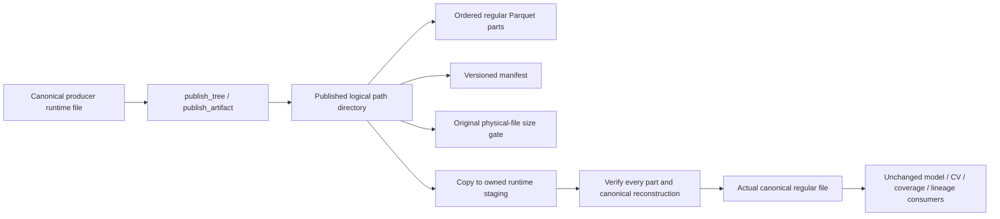
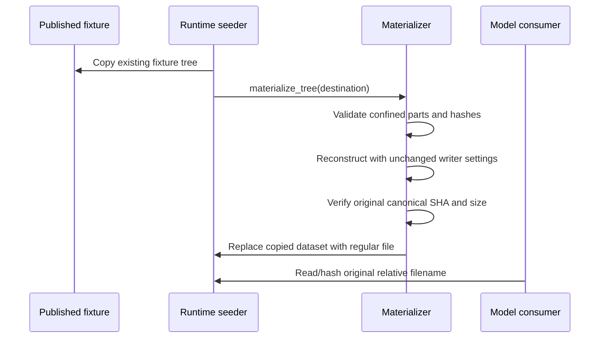

# Lossless published Parquet

The reviewed storage branch keeps published CI files below the original 90 MiB ceiling while giving model consumers real canonical regular files. Input data, float precision, row order, model/CV identities, writer settings and original assertions remain unchanged. Main checkout, active kernels and source fixtures are untouched.

## Source ownership and flow

[`published_artifacts.py`](../../case_studies/utils/published_artifacts.py) owns publication, manifest validation and reconstruction. Oversized canonical Parquet is split into contiguous row ranges using the existing writer settings; measured oversized parts are split again. A source that cannot reproduce its original bytes fails instead of being silently re-encoded. Ordinary files copy byte for byte.



The version-one manifest records ordered filenames, actual part sizes and SHA256s, original canonical byte size/SHA256, ordered schema and row count. Validation rejects escaping paths, symlinks, duplicate or reordered names, unlisted entries, wrong size/checksum/schema/row count, and reconstructed canonical checksum drift. The manifest is a claim checked against real bytes, never an authority accepted without reconstruction.



[`seed_case_study_intermediates`](../../tests/conftest.py) materializes only its copied destination. `seeded_output_dir` already sets `ML4T_OUTPUT_DIR`, and [`get_case_study_dir`](../../utils/paths.py) routes consumers there. [`create_experiment`](../../scripts/create_experiment.py) performs the same operation in its private staging tree before publishing the workspace. CI's existing explicit copy steps invoke the same module afterward. The publication fixture root and its original size gate are unchanged.

Publication-side [`fixture_registry`](../../tests/fixture_registry.py) and [`artifact_audit`](../../scripts/artifact_audit.py) reconstruct into a private temporary cache to hash actual canonical bytes. They retain single-file behavior and count a dataset as one logical artifact, rather than treating its physical parts as separate model inputs. Audit output separately names canonical bytes and total physical publication bytes.

The independent model-registry suite still expects installed canonical `case_studies/<id>/features` inputs. Bootstrap those from the verified runtime view; this branch does not modify its tests or peer-owned fixture code. Installed artifact downloads currently cover `run_log` only, so that downloader is not repurposed as a feature installer.

## Commands

Run from the project root using its existing environment:

```bash
python -m case_studies.utils.published_artifacts publish CANONICAL_INTERMEDIATES NEW_PUBLICATION_INTERMEDIATES
python -m case_studies.utils.published_artifacts materialize OWNED_RUNTIME_COPY
```

Publication requires a new destination outside the source tree and preserves source data. Materialization is expressly a runtime/staging operation: do not invoke it on a published source tree. Ordinary files and repeated materialization remain unchanged. Portable replacement of a nonempty dataset directory uses verified staging, two same-filesystem renames and rollback on an operational error; a process crash between the renames can leave the owned backup in the temporary staging directory. It is not claimed to be a single atomic directory-to-file exchange.

## Evidence and original-case coverage

The genuine financial artifact has 558,456 rows and 120,527,027 canonical bytes. Its two published parts contain 60,964,707 and 59,629,985 bytes. Reconstructed SHA256 is exactly `ffa3cd85815f998dfa30a0b05fd8175fbed36c8f8527e689a59e3650d8246679`; order, schema, nulls and every Float32 bit are preserved. Eight corruption/escape controls were rejected without altering their copied datasets. [Implementation control](mlft-shards-implementation-control.json).

The separate full publication contains 1,177 physical files, largest 93,799,859 bytes (below 94,371,840). All 1,174 ordinary files were independently checked byte-identical. The six NASDAQ logical feature/label hashes match the canonical source; the original source stays unchanged and the published financial path stays a directory. [Publication audit control](mlft-shards-publication-audit-control.json).

The original ceiling was observed failing on the 114.9 MiB canonical file before implementation. [Baseline log](mlft-size-gate-before.log). The original five immutable guards, lineage source and writer settings remain byte-identical to branch base `a92c3f31`. [File hashes](mlft-immutable-files.json).

Original routing/codec/lineage/audit/registry cases: **129 passed**. [Log](mlft-shards-existing-routing-tests.log). Additional base identity run: **29 passed, 7 existing missing-data skips, 1 unchanged CAE failure** (expected `82a8721e8c074459`, actual `22ba1b43276579c8`). This older isolated branch needs integration with peer fixes; no golden or version was changed. [Identity log](mlft-shards-existing-identity-tests.log).

The broader published-fixture consumer run: **41 passed, 7 existing missing-registry skips, 1 missing US-equities input failure**. That source fixture does not contain `data/equities/market/us_equities/us_equities.parquet`; no data was fabricated. The NASDAQ original consumer and original physical budget cases passed. [Full scoped log](mlft-published-original-gate-consumers.log). Final focused run: **132 passed, 0 failed, 0 skipped**, including the unchanged physical ceiling and genuine NASDAQ model consumer. [Final existing-case log](mlft-shards-final-existing-tests.log).

No additional pytest cases, assertion repins, gate filters or skips were introduced. One-off diagnostic scripts and their JSON evidence are retained alongside this document. Full multi-repository or complete MLFT suite success is not claimed by this storage branch.

Both controlled rename-failure positions preserved the exact copied dataset. Noncanonical encoding and an unsplittable genuine input row were rejected with source checksums unchanged. [Rollback proof](mlft-shards-operational-rollback.json), [rejected publication proof](mlft-shards-rejected-publication.json). A genuine NASDAQ `create_experiment` staging control reconstructed the exact canonical SHA and preserved the published source; [experiment evidence](mlft-shards-genuine-experiment.json). The existing workspace cases were rerun after the standalone script import-path adjustment; [workspace log](mlft-shards-final-workspace-tests.log). Ruff and `git diff --check` pass.

Independent root review and integration with the current main fixes remain pending. This worktree is based on `a92c3f31`; it does not overwrite peer-owned main changes or claim the unchanged CAE baseline failure is resolved.
