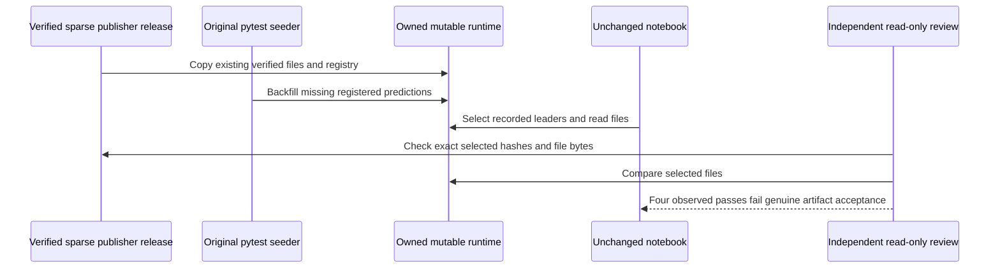

# Canonical reader fidelity audit

## Verified releases and sparse artifacts

Eight of nine official v3.1 bundles pass every unchanged [installer gate](../../scripts/download_artifacts.py): outer SHA 256, all internal manifest hashes, SQLite page integrity, foreign keys and checkpointed registry state. The ETF bundle is rejected for three orphaned records referring to absent prediction `018b37c30d7f`. [Final release gate evidence](mlft-official-release-gates.json) preserves all outcomes. An accepted archive can still omit files named by retained historical registry rows; checksum integrity is not complete reader coverage.

The owned reader view preserves all verified publisher trees and uses writable copies for the original pytest seeding protocol. Its assembly provenance now enumerates all eight verified roots. The audited reader attempt used unchanged source, tests and mathematical assertions; the subsequent one-line MLflow correction is separately reviewed.

## Original seeder can synthesize missing scores

The unchanged [fixture](../../tests/conftest.py) invokes [seed_results](../../tests/fixtures/seed_results.py). Existing prediction artifacts survive, but missing registered hashes receive synthetic fixture scores; their digests are then recorded. This is authored test-harness behavior. It cannot serve as proof that missing canonical predictions were recovered.

Ten selected original Chapter/Docker reader cases finish **four passed and six failed** in 133.14 s. The passing linear and latent-insight pairs remain mechanically observed test passes, but independent review **rejects all four as genuine canonical-reader acceptance**. Reconstruction against the actual owned runtime `pytest-268`, associated by creation time with the recorded reader command, shows synthetic selected files.

| Selected artifact | Audit outcome |
| --- | --- |
| Linear primary CME `29b3e1576947` | Missing from verified publisher source; present after seeding |
| Latent paired supervised CME `0172512dacae` | Missing publisher file; runtime backfill |
| Latent paired supervised US `df081818e2a4` | Missing publisher file; runtime backfill |
| Four selected latent winners | Exact publisher bytes preserved |

Across 127 distinct selected prediction files,20 exactly match verified official bytes,105 exist only after runtime backfill and two ETF files come from the prior fixture. These counts concern reconstructed source selections, not all registered predictions. [Read-only file comparisons and association proof](mlft-reader-fidelity-provenance.json) retain limits; executed notebook serializations are deleted by the original helper, so source-query reconstruction is explicitly distinguished from retained execution output.

## Outstanding reader failures

The GBM-insight pair reaches missing learning curve `81c7a1648ea0`. The drift pair reaches its original session-count assertion after selecting files absent from the publisher archive. That does not prove the real publisher streams have inadequate sessions; the harness supplied fallback scores. The MLflow pair reaches a source sampling defect: selecting leader training hashes expands eight winners to 61 checkpoint rows, and the original 50-row cap drops two winners. The independently reviewed [sampling correction](mlflow-leader-sampling.md) selects the actual winner rows. Both original cases and direct genuine-registry execution pass; the cap and all assertions remain unchanged.

The workspace keeps both counts: **7,695 observed original-case passes,466 original skips and 166 failures**, plus **four rejected genuine-reader acceptance gates**. There is no full-suite green claim. Genuine-reader recovery must use the unchanged source against verified publisher files without synthetic backfill, or recover the missing authentic artifacts. Newly produced current features are not relabeled as the archived training generation; see [producer and source-lineage scope](us-equity-producer-recovery.md).
