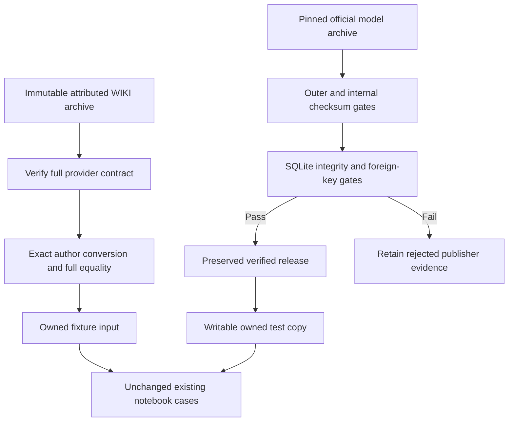

# Genuine input and artifact recovery

## Frozen US equities input

The [original downloader](../../data/equities/market/us_equities/download.py) requests the full frozen WIKI/PRICES table. Its [provider maintainer at immutable source revision](https://raw.githubusercontent.com/ml4t/data/4b783bfdfbfa2e05a8297308cd9068fea95e4741/docs/wiki_prices_status.md) explicitly identifies the attributed [version-one Kaggle mirror](https://www.kaggle.com/datasets/marketneutral/quandl-wiki-prices-us-equites) as the complete source: **15,389,314 rows, 3,199 tickers, fourteen columns, 1962-01-02 through 2018-03-27**. The anonymous immutable download returned HTTP200. The normal official export returned HTTP403 and requires an API key; official-export binary equality is unverified.

Full coverage, unique ticker/date keys and finite non-null numeric values pass. The original provider conversion preserves all fourteen columns and all rows, including nulls; exact full CSV/Parquet roundtrip passes. Authentic missing values and OHLC anomalies remain unchanged. No rows were removed, imputed or repaired. The [original loader](../../data/equities/loader.py) keeps raw prices and adjusted corporate-action fields separately.

| Artifact | SHA256 | Bytes |
| --- | --- | ---: |
| Immutable ZIP | `adfd226694c6f3ec2c56b585d973764180a39a3ec516601721e90096dc1de94f` | 463,184,323 |
| WIKI_PRICES.csv | `ca7fb174c7948db85638917d25ff65d438e27d5cb23675da784c54db01e3d003` | 1,797,003,576 |
| Converted Parquet | `0f4fd66ac3e5c2ecb04fc6a5c7de711cfd639becf7a20cf0a3252dc5c3b3b005` | 521,996,483 |

Root independently verified the provider source and Parquet hashes, copied the genuine bytes into the isolated fixture and verified the destination hash. The [promotion proof](mlft-full-wiki-equities-promotion.json) retains the complete conversion evidence. Main user intermediates, source, tests and assertions remain unchanged.

Actual original cases: **both Chapter/Docker network-portfolio notebooks pass** in16.69 seconds. The ten selected original data-chapter cases finish **eight passed, two failed** in47.49 seconds: EDA, corporate actions, data-quality and survivorship pairs pass; the point-in-time pair reaches its real missing `FRED_API_KEY`. Source recovery does not establish availability of authenticated FRED history.

A further twelve unchanged latent-factor, transaction-cost, execution and drift cases finish **eight passed, four failed** in92.39 seconds. Eigenportfolios, stochastic discount factor, supervised autoencoder and execution-impact pairs pass. The cost-taxonomy pair now reaches missing genuine CME daily bars; the drift pair reaches missing original US-equity validation predictions. This recovery clears **eighteen** formerly failed cases in total.

## Checksum-pinned model bundles

The unchanged [author installer](../../scripts/download_artifacts.py) pins v3.1.0 archives and validates the outer checksum, every internal manifest artifact, SQLite integrity, foreign keys and absence of uncheckpointed registry WAL. The [official release](https://github.com/stefan-jansen/machine-learning-for-trading/releases/tag/v3.1.0-artifacts) provides canonical trained outputs. All archives and recovered run logs stay in owned isolated storage; user/main run logs are preserved.

FX pairs, CME futures and crypto funding bundles pass every original installer gate. The ETF archive matches its pinned outer checksum and all1,751 internal file checksums. SQLite page integrity is `ok`, but its publisher registry has **three foreign-key violations**: one row each in `fold_metrics`, `prediction_metrics` and `prediction_coverage` refers to absent prediction `018b37c30d7f`; the corresponding prediction artifact is absent. The original installer correctly rejects it. No orphan rows, hashes or expected populations were changed to admit it. Other bundle recovery and original reader validation remain in progress.

The production installer leaves verified releases read-only. Original pytest seeding expects to copy and update its owned registry. The first reader attempt exposed preserved read-only permissions; the retry uses writable **owned copies** while leaving verified publisher files and hashes untouched. The retry finishes six failed original reader cases: all advance beyond their former FX prerequisite and now require complete US-equity linear, GBM and latent-factor results. No reader pass is claimed from that prerequisite progress.

The [exact node ledger](mlft-original-case-coverage.json), [failure traces](mlft-original-failure-explanations.json) and [portable command evidence](index.md) distinguish terminal original-test outcomes from ongoing producer work. No additional test cases or market data were invented.
