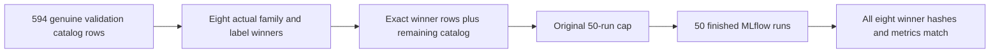

# Preserve MLflow leaders within the run limit

The [experiment notebook](../../26_mlops_governance/06_mlflow_experiments.py) chooses the best validation result for each family/label group. Filtering the whole catalog by the winning training hashes admits every checkpoint for those training runs. With the genuine author registry, eight winners expand to 61 rows; the original 50-row cap drops two winners and the original coverage assertion fails before logging.

The reviewed one-line correction takes `best_validation.copy()` as the leader rows. Remaining catalog sampling, the 50-run cap, original labels/configurations, parity tolerance and all four mathematical/coverage assertions remain unchanged. There is no increased limit, model substitution or weakened expected value.

Independent source review reproduced the original 61-row expansion and candidate coverage against the immutable official US registry. A direct run of the original source fails at the sampling assertion in 6.30 s. The candidate passes in 7.69 s, using that same verified registry with **no `seed_results` invocation**. The retained executed notebook records 50 logged/searched runs and eight matching hash/metric rows. [Direct red/green evidence](mlft-mlflow-direct-original-red-green.json) and [unchanged source/assertion verification](mlft-mlflow-sampling-candidate-verification.json) retain scope.

An additional direct run captured a read-only SQLite backup before the notebook's unchanged cleanup. Root independently verifies its SHA 256 `c6cbabf03a26045f930f1ae4f24ee6a5a265b92239f4dd95bbad063b8b3ec473`,50 finished runs, page integrity and zero foreign-key violations. [Live capture](mlft-mlflow-genuine-live-snapshot.json) · [Root database verification](mlft-root-genuine-mlflow-db-verification.json).

On the integrated maintained source, the two original Chapter/Docker MLflow cases pass in 261.92 s wall time. Fresh wheel and source-distribution builds pass in 2.46 s; all 1,218 tracked Python files compile strictly, with all four original notebook assertion ASTs identical. [Main verification](mlft-main-reviewed-mlflow-source-verification.json) · [Exact commands](index.md). No additional test cases were added.

This genuine registry-catalog validation is separate from the [four rejected reader-fidelity passes](canonical-reader-fidelity.md). It does not establish archived training-input or holdout compatibility.
