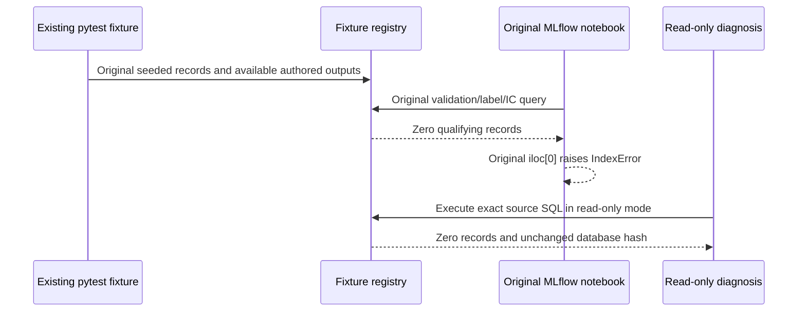

# Remaining existing-test prerequisites

The maintained inventory still has 215 failed nodes. These diagnostics explain causes; they do not turn failed tests into passes. The [node coverage](mlft-original-case-coverage.json) and [original failure trace summaries](mlft-original-failure-explanations.json) preserve their original outcomes.

## MLflow experiment catalog

Both unchanged Chapter and Docker [MLflow notebook](../../26_mlops_governance/06_mlflow_experiments.py) nodes were rerun on current source `b208ca666d77`: both fail at `best_validation.iloc[0]`. A separate read-only query executes the exact SQL extracted from that source against the registry created by the existing pytest fixtures. It returns **zero qualifying validation records**, despite 21 training rows, 21 prediction rows, 21 metric rows and four backtest rows. The registry SHA is identical before and after the read.

The original selector requires the original two labels, a validation split, non-null IC and positive IC day coverage. Existing fixture rows do not satisfy that contract. Changing the labels, admitting incomplete metrics, selecting a different study, or fabricating a prediction would change what the notebook claims to demonstrate. Genuine US-equity producer output is needed. The [SQL and registry proof](mlft-current-mlflow-empty-validation-diagnosis.json) records the exact query, source hash and counts. This proves the missing catalog prerequisite; it does not establish a Pandas indexing regression or certify any unseen prediction set.

## SEC supply-chain workflow

The [original supply-chain producer](../../23_knowledge_graphs/02_supply_chain_kg_construction.py) already ships its [extracted triples](../../23_knowledge_graphs/output/supply_chain_cache/extracted_triples.parquet) and [immutable metadata](../../23_knowledge_graphs/output/supply_chain_cache/extracted_triples.meta.json). The default cached route **does not require CUDA**. CUDA is required only when regeneration is requested or the cache is missing. The cache's SHA is `b20bdf979f79bc32afb9760d979ff533a162dc053618fe81af78dbc4830e29f5`, with 2,049 triples.

The default route still reads genuine full SEC filing records before loading and analysing the cached graph. The missing 10-K records are now recovered: 601 genuine filings across 101 symbols, with matching text lengths. Six original construction/RAG/graph-feature cases pass and the owned snapshot holds 817 entities and 995 edges. The [unchanged canonical downloader](../../data/equities/fundamentals/filings_download.py) fetched its declared 101-company, 2020–2025 10-K corpus using the repository's configured real EDGAR identity. The separate uncapped 8-K recovery exposed an accession-prefix cache collision. Two original preview cases passed on its genuine but incomplete rows; complete corrected coverage is still being rebuilt. See [cache repair and precise recovery scope](sec-filing-cache-identity.md).

The owned Neo4j service is available; a healthy empty service alone does not establish the named supply-chain snapshot. The cache, corpus and snapshot are different prerequisites.

## Other outstanding scopes

Explicit traces require FRED/DataBento authentication, complete FX model populations, US-equity datasets and model outputs, canonical deep-learning results, complete validation/holdout populations and publication fixtures. Each retains its failed identity. CPU previews, reduced coverage and different public datasets cannot be relabelled as those original populations.
