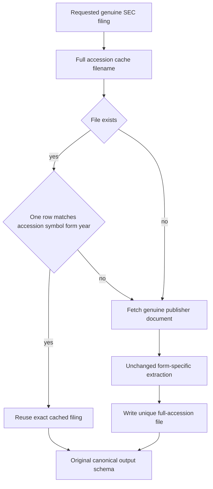

# SEC filing cache identity and corpus recovery

The [canonical downloader](../../data/equities/fundamentals/filings_download.py) now addresses each cache entry by the complete SEC accession. It reuses exactly one cached row only when its accession, symbol, exact form and year match the requested filing. Unreadable or mismatched entries fall through to genuine publisher extraction. Original extraction rules, year filters, universe, metadata construction and output schema remain unchanged.

## Why the old key was incorrect

The previous filename retained only the first 12 digits after removing accession hyphens. Those digits identify a filing agent and year, not the unique filing sequence. Actual AAPL metadata contains 51 distinct 2020–2025 8-K accessions but only 12 such keys. The retained old cache would incorrectly reuse a different filing for 39 requests. Final output deduplication concealed those repeated records; a successful process exit did not establish complete coverage.

The [publisher metadata and retained-file proof](sec-cache-real-prefix-collision-evidence.json) records every collision. A live three-filing control returned the third accession incorrectly under the original source and correctly after repair. Replay of the corrected full keys is identical. Controls using real retained records with wrong accession, symbol, form or year are rejected; no invented filing contents or new pytest cases were introduced. The [exact red/green control](sec-cache-actual-downloader-red-green.json) and [candidate verification](sec-cache-candidate-verification.json) retain scope and source identity.

## Source and test verification

The maintained source exactly matches the independently exercised candidate SHA `65712f2d2bb61fb4c450ac8394c27c00857ef8fa8c03000c3f15435466a1147d`. The 33 existing fixture/data-exception cases pass on main. Wheel/source-distribution builds and strict compilation of all 1,218 tracked Python files also pass. No model formulas, populations, financial expectations, test cases or assertions change.

Legacy prefix files remain untouched. A separate [validated migration](mlft-sec-validated-full-accession-cache-migration.json) copied 1,850 actual single-record files to their own complete accession keys, checking symbol, form, year, accession format and text length. It did not infer records for the other colliding accessions or mutate legacy bytes.

## Authentic corpus and graph results

The genuine 10-K corpus contains 601 filings over 101 symbols and 2020–2025; [source proof](mlft-genuine-sec-full-downloader-source-proof.json) retains its SHA and text-length validation. On the correctly selected original data path, the unchanged supply-chain construction, graph-RAG and graph-feature Chapter/Docker cases all pass: six passes. The [owned Neo4j snapshot](mlft-genuine-sec-supply-snapshot.json) has 817 entities and 995 edges and carries the unchanged Qwen extraction-cache hash. Default cached extraction does not require CUDA.

The two original SEC preview cases also passed their schema checks on 1,249 genuine unique 8-K rows. That earlier prefix-colliding run does **not** establish the complete 8-K corpus. Its output is preserved separately; the repaired uncapped 101-company, 2020–2025 downloader is now rebuilding the actual distinct filings. Corpus completeness remains pending until publisher accession coverage is verified. A preview pass is not promoted into a full-data claim.

The two network-portfolio cases still require the separate unavailable US-equity dataset. Source build success, graph validity, input-schema validation and whole-corpus coverage remain distinct evidence.
