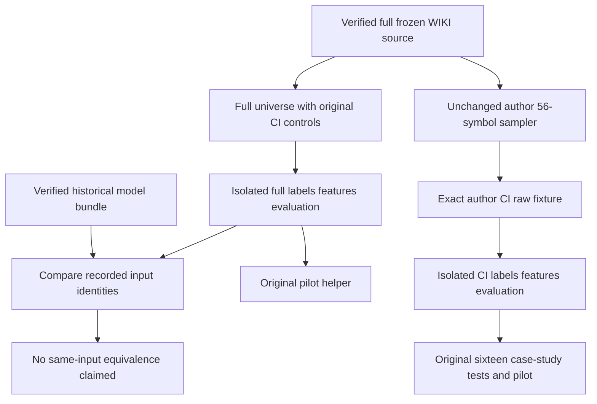

# US equity producer recovery and validation scope

## Current source and genuine inputs

The [full frozen WIKI recovery](genuine-input-artifact-recovery.md) supplies actual source rows. The unchanged [author CI sampler](../../tests/create_test_data.py) selects its exact declared 56-ticker list without numerical transformations:342,525 rows over 1962-01-02 through 2018-03-27. Full equality to direct source filtering passes; its Parquet SHA 256 is `82e003dfae89eb561a9b8e43e8ac417a5bb36847e9b72a5ee6adb0b8c95a4dbc`.

The unchanged [intermediate builder](../../tests/generate_intermediates.py) and [original controls](../../tests/overrides.yaml) run the [feasibility](../../case_studies/us_equities_panel/01_feasibility_analysis.py), [labels](../../case_studies/us_equities_panel/02_labels.py), [financial features](../../case_studies/us_equities_panel/03_financial_features.py), [model features](../../case_studies/us_equities_panel/04_model_based_features.py) and [evaluation](../../case_studies/us_equities_panel/05_evaluation.py) stages. Both retain the original 1996 start and cross-sectional controls, even when the raw universe is full. No stages 06+ or trained populations were produced by these prerequisite builders.

| Scope | Actual result | Feature coverage |
| --- | --- | --- |
| Full frozen raw universe with original CI controls | Five stages pass,588.78 s | Financial 9,249,401 rows/3,176 stocks/64 columns; model features 9,251,732 rows/3,177 stocks/11 columns |
| Exact author 56-symbol CI raw fixture | Five stages pass,228.56 s | Financial 221,111 rows/56 stocks/64 columns; model features 221,165 rows/56 stocks/11 columns |

Every feature/label key is unique. The full scope preserves all three original return horizons; financial artifact SHA 256 is `7322875789d0e2f0184007fd7a0a026e067a57d4b7aaa7956ae86f6ca6a89b0a`. Five successful stages do not establish a canonical trained generation. [Full terminal command](mlft-full-original-us-producer-result.json), [CI terminal commands](mlft-authored-ci-us-producer-result.json) and [unchanged source proof](mlft-us-producer-source-boundaries.json) preserve boundaries.

## Existing tests

The original [pilot helper](../../tests/test_artifact_specs.py) passes against full genuine inputs in 11.48 s. The first owned view accidentally omitted the new case-study directory because it copied only the old fixture's existing entries. That setup error was traced and corrected; failed attempts remain retained, with no product or test modification.

On the exact author CI fixture, the pilot plus original first five [case-study tests](../../tests/test_case_studies.py) pass in 136.74 s. All eleven remaining originally failing US-equity case-study nodes pass in 133.31 s, preserving their original settings, population names, mathematical assertions and test inventory. This clears **seventeen distinct existing failures**. Their fixtures retain the original authored test-seeding protocol; these passes validate that existing CI scope, not a full production-trained population or historical model-input equivalence.

## Archived model inputs are a different generation

The official US bundle pins source `64677fbc102b1c26c22a3efca9253e4a63187959` from September 19. **All 132 archived training specs declaring inputs differ from current producer byte identities and label-sidecar digests; three older specs declare no artifact inputs.** No expected hashes were changed. The archive does not contain the underlying feature frames needed to establish their numerical equivalence.

There are substantive source differences, beyond storage or dates. Current [feature-window regression tests](../../tests/test_feature_windows_count_sessions.py) enforce contiguous-run boundaries. The historical canonical feature windows crossed 223 gaps at 21 sessions and 18,553 at 252 sessions; regenerated current inputs must have zero such windows. Reverting the current feature correction would change the maintained branch's intended behavior. Historical-source input recovery, if successful, remains an explicitly separate legacy snapshot and never replaces current source or current CI outputs.

The [reader fidelity report](canonical-reader-fidelity.md) separately audits whether reader-selected predictions are publisher files. Passing a test that backfills missing scores cannot establish genuine canonical acceptance.

## Separate historical input snapshot

An explicitly isolated historical control uses unchanged source `64677fbc102b1c26c22a3efca9253e4a63187959`, its full frozen graph, Python 3.14.3, Polars 1.41.1 and the original production defaultsSTART_DATE=1990 / XS_MIN_STOCKS=50 / MAX_SYMBOLS=0. All five producer stages pass on macOS in 943.13 s. This platform difference is recorded, not assumed equivalent to the author's Linux host.

Literal canonical identities are recovered for all three labels and the financial feature file. In particular, one-day labels have SHA 256 `41219685fd9b51175d9d660550a1f8e62b2154c34f1ce943fb1e85c219eaec96` and value digest `a6c40b6062b51db8`; financial features have SHA 256 `4472a9609dd9997fb2d1cf113b8e31b66187779f3dcd55bcf89a8c838a103144`,4,478,156,899 bytes. These are actual matches to recorded author inputs, not rewritten expected hashes.

Model-based features remain different: actualSHA `51960f2ec8b1cc9ef16d6534dc5328da86261de60591923d5602bfd8012f715b` and original row-value digest `742aa039485cd355`, versus archived notebook digest `f6f40ca369d56f9b` and recorded artifact vintages `0e74d15…`/`86ece972…`. Thus no complete same-input training-spec equivalence is established. Partial identity recovery cannot admit a different temporal frame or repin a model identity.

A separately frozen Linuxx 86_64 environment with 491 distributions installs and imports successfully. The shared Docker VM has 7.746 GiB; the actual historical financial stage uses 32.172 GiBRSS. Shared VM resources and the user's concurrent Quasar services were not resized, restarted or stopped. Linux producer capacity and remaining exact temporal-input recovery stay explicit limitations.
